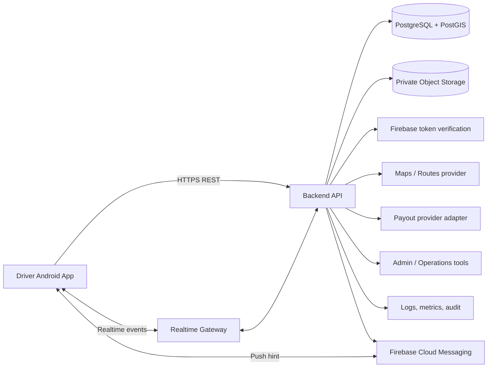

# System Architecture — Drive Partner

**Document ID:** DP-ARCH-001 | **Version:** 1.0

## 1. Objectives
Use a secure, testable and evolvable platform without premature microservices: native Android client plus a TypeScript modular-monolith backend. PostgreSQL is the source of truth for orders, trips, driver state transitions and money. Realtime and push are delivery channels, not authoritative databases.

## 2. Context diagram


## 3. Backend domain modules
| Module | Responsibility / owned data |
|---|---|
| Identity | Token verification, user and role mapping |
| Onboarding | Driver profile, vehicles, application progress |
| Verification | Document metadata, reviewer decisions, expiry |
| Availability | Duty state, zones, latest permitted location |
| Dispatch | Offer creation/expiry, accept/reject and assignment |
| Trips | Lifecycle, cancellation and immutable event history |
| Pricing | Versioned fare rules and quote snapshots |
| Earnings | Earning statements and adjustments |
| Ledger | Append-only financial postings and balance view |
| Payouts | Requests, provider adapter and reconciliation |
| Incentives | Campaigns, eligibility and rewards |
| Referrals | Attribution and qualification |
| Safety | SOS/incident intake and escalation |
| Support | Tickets, messages and attachments |
| Notifications | Outbox, templates, delivery and inbox |
| Admin/Audit | Role-bound operations and privileged-action audit |

Modules communicate through explicit application services/events. Avoid arbitrary cross-module writes. One deployable backend is appropriate initially; split only when evidence supports it.

## 4. Android architecture
Feature-oriented structure:
```text
app/
  core/{common,network,location,maps,notifications,designsystem,security}
  feature/{auth,onboarding,documents,home,availability,offers,trips,orders,
           earnings,wallet,rewards,referrals,safety,support,profile}
  navigation/
  data/       # repository implementations
  domain/     # models and use cases
```
- Compose renders immutable UI state and emits user intents.
- ViewModels expose `StateFlow` and coordinate use cases.
- Repositories abstract APIs/cache; DTOs do not leak into UI models.
- UI does not calculate authoritative fare, wallet or eligibility.
- Restore critical state from backend after process recreation.

## 5. Key interaction flows

### Authentication
1. Android signs in through Firebase Phone Auth.
2. Client sends Firebase ID token to backend over HTTPS.
3. Backend verifies token signature, issuer, audience, expiry and applicable revocation state.
4. Backend resolves internal user/driver and role; never trust client-supplied role.

### Online availability
1. Driver asks to go online.
2. Backend checks account, mandatory documents, vehicle, category, zone and suspension status.
3. Backend persists presence state and returns confirmation.
4. App starts compliant duty-location behavior only after permission and server approval.
5. Updates are rate-limited and purpose-limited; backend checks freshness and accuracy.
6. Offline request is persisted; location updates stop when safe, respecting active-trip policy.

### Offer and acceptance
1. Dispatch selects eligible candidates based on approved rules and fresh location.
2. Backend creates an offer with unique ID, server expiry and quote snapshot.
3. Realtime gateway signals driver; FCM is fallback/wake hint.
4. App fetches offer details from authenticated API.
5. Driver explicitly accepts or rejects.
6. A DB transaction checks offered status, expiry, online eligibility and unassigned order; exactly one driver wins.
7. App syncs authoritative state. Duplicate taps/events do not create duplicate assignment.

### Financial posting
1. Server validates trip completion.
2. Pricing service calculates final amount from versioned fare configuration and trip facts.
3. Earnings creates a statement.
4. Ledger posts balanced entries in a transaction with unique source reference.
5. Wallet is derived from ledger or a transactionally maintained projection.
6. Payout adapter submits transfer idempotently.
7. Signed provider callback and reconciliation confirm settlement. Client never marks payout paid.

## 6. Data and consistency
PostgreSQL + PostGIS is the transactional source of truth. Use relational constraints, transactions, indexes and integer paise plus currency. Store timestamps in UTC. Use geospatial indexes for proximity/zone queries. Retain location history only for documented operational purpose and reviewed retention period.

Redis may later support ephemeral presence, candidate cache, rate limits or temporary locks. It is never the final guard against double assignment; the database transaction is. Never make Firestore and PostgreSQL competing sources of truth for financial or order state.

## 7. Realtime and push
- Authenticate WebSocket/realtime connections and scope events to the driver.
- FCM payload contains minimal event ID/type/expiry hint, not sensitive order/customer/financial details.
- On reconnect, client fetches current driver state, active offer and active trip.
- Events have unique IDs and schema versions; clients deduplicate.
- Push is not guaranteed; server expiry and authoritative state work independently of delivery.

## 8. Location architecture
- Wrap Fused Location Provider behind a testable interface.
- Request foreground location contextually; background permission only for a genuinely required, disclosed, policy-compliant feature.
- While on duty, use the appropriate foreground service and persistent notification when required by OS/Play policy.
- Stop duty tracking when offline unless active work/approved safety need justifies it.
- Use adaptive update intervals; avoid unnecessary high-frequency collection.
- Validate timestamps, accuracy and implausible jumps. Do not expose raw location to unauthorized users.

## 9. Integration adapters
Provide interfaces for Firebase Auth, FCM, Maps/Routes, private object storage, payout provider, phone masking/communications and verification/insurance providers. Core business modules must not depend directly on one vendor's SDK. Dev/staging use sandbox adapters; missing credentials show unavailable, not fake success.

## 10. Security boundaries
Android is untrusted. Every resource read/write is authenticated and scoped. Admin actions require server-side roles and audit. KYC storage is private and uses short-lived authorization. No secrets in APK/source/logs. Use TLS, secret manager, least privilege, key restriction/rotation and audits for sensitive decisions.

## 11. Deployment topology
Separate Android/backend dev, staging and production. Use managed PostgreSQL with backups and restore drills, private object storage with retention policy, segregated Firebase config, restricted Maps keys, structured logs, metrics, crash reporting and alerting. Use backward-compatible API/database migrations and an expand-migrate-contract strategy.

## 12. Baseline ADRs
- ADR-001: Native Kotlin/Compose, not a web wrapper.
- ADR-002: Modular monolith first.
- ADR-003: PostgreSQL/PostGIS owns transactional order and financial state.
- ADR-004: Firebase Auth/FCM are support infrastructure, not money/order source of truth.
- ADR-005: Backend owns dispatch, pricing, rewards, ledger and payouts.
- ADR-006: Realtime + push fallback + state resync.
- ADR-007: Demo fixtures isolated and visibly labelled.

Changes require rationale and impact analysis in `10_memory.md`.
