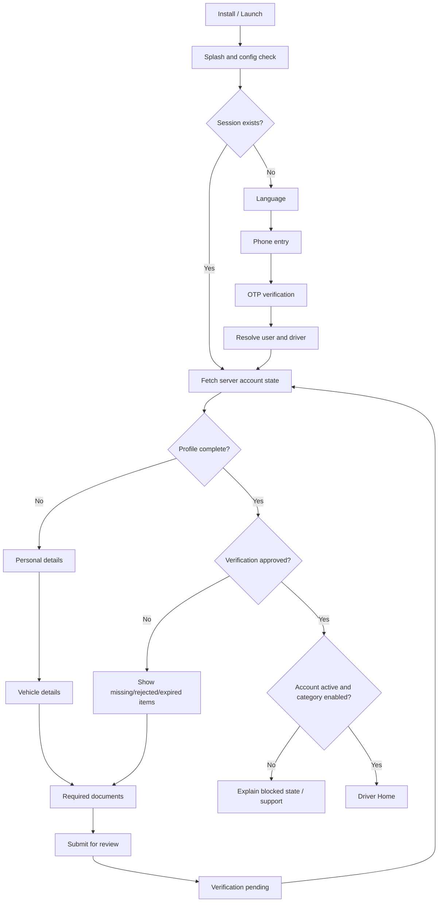
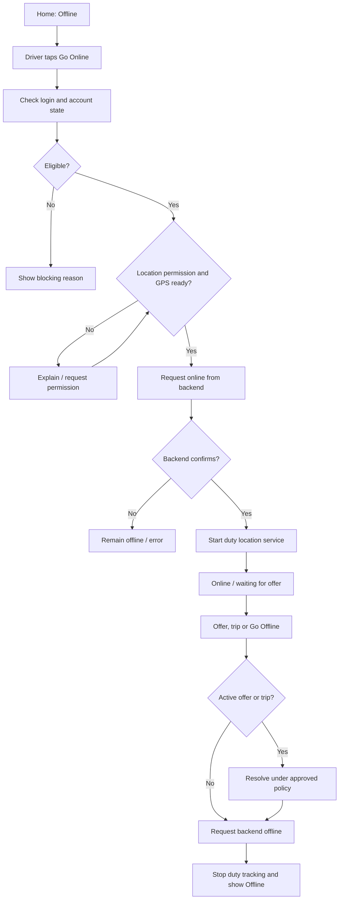
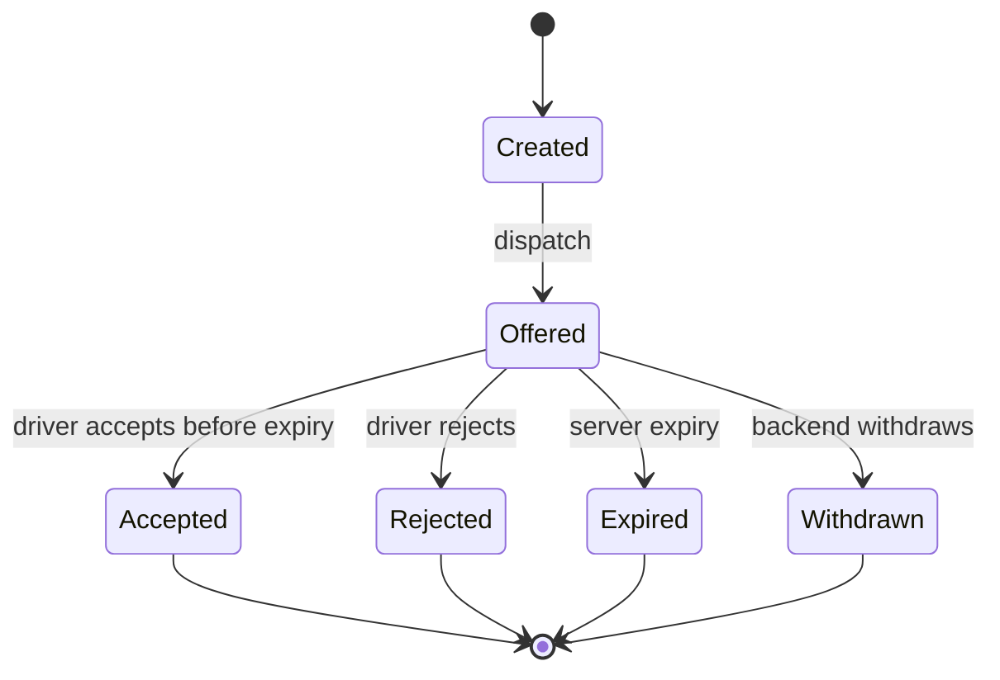
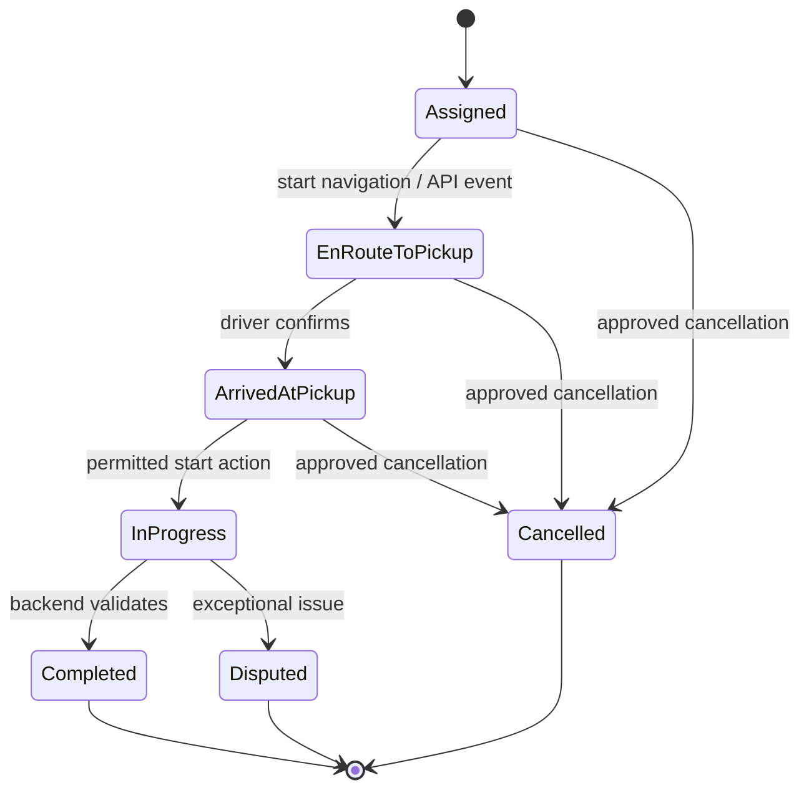
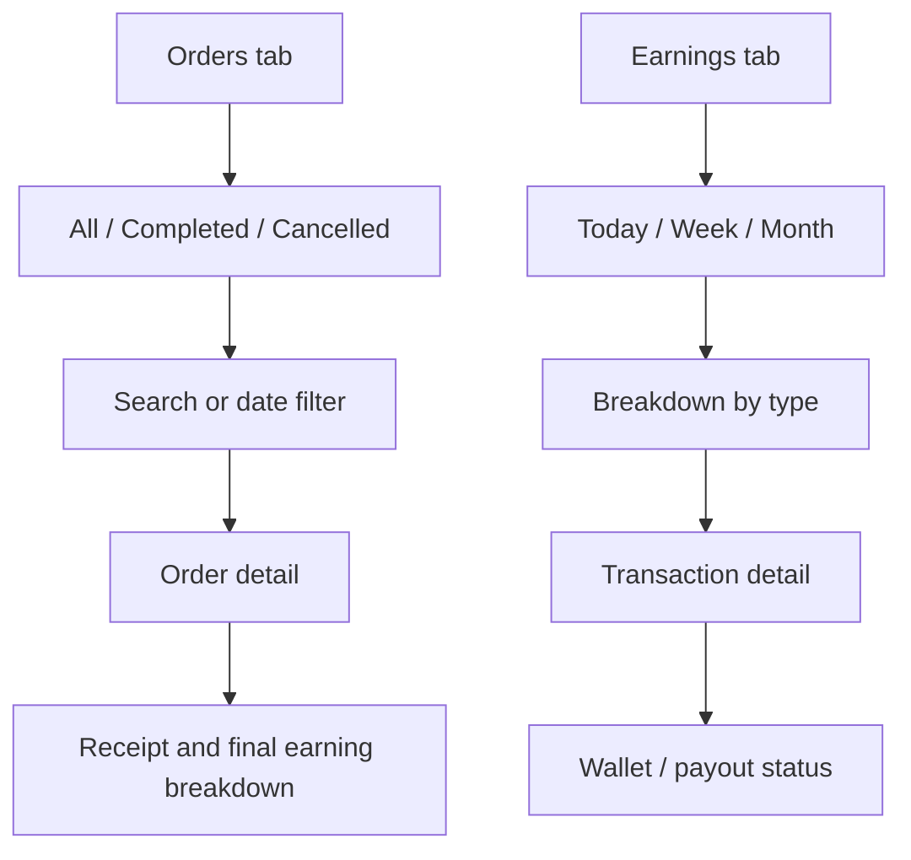
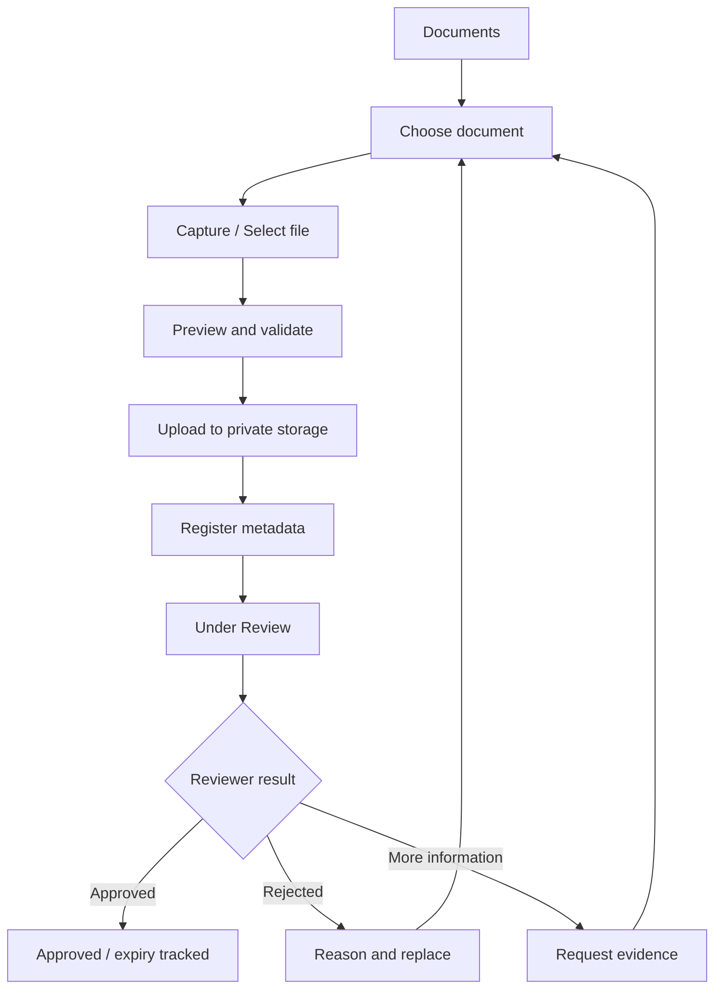

# Application Flows — Drive Partner

**Document ID:** DP-FLOW-001 | **Version:** 1.0

## 1. Navigation model
Activated-driver primary destinations: Home, Orders, Earnings, Rewards and Profile. Home contains duty control. Side drawer/secondary navigation contains documents, vehicle, service area, safety, support, language, settings and legal links. Active offer/trip state must remain recoverable and take priority over ordinary navigation.

## 2. First-launch and onboarding

Rules: persist draft progress server-side; local draft is not proof of approval. OTP and document verification are real provider/backend flows in Live Mode. Rejected documents show a reason and replacement action. Request Android permissions in context, not all at first launch.

## 3. Duty and availability

If backend is unreachable, show pending/unconfirmed or last confirmed state. Never optimistically claim online. Do not silently abandon active trips during an offline action.

## 4. Offer lifecycle

On an incoming event: deduplicate by event/offer ID; fetch offer from API; verify current driver and actionable status; calculate countdown from server expiry using server-time offset; require explicit accept/reject; refresh state on app resume. Never queue an offline accept.

## 5. Trip lifecycle

The API contract must define the exact persisted states. Any proximity/customer checks are backend policy, not fabricated client checks.

## 6. Trip-screen action matrix
| State | Main action | Secondary actions | Server result |
|---|---|---|---|
| Assigned | Start navigation | Help/contact if configured | Remains assigned or transitions per API |
| En-route | Mark arrived | Navigate, help, contact | Arrival event |
| Arrived | Start trip | Help/cancel if permitted | Trip started |
| In progress | Complete trip | SOS/support | Completion validation and final fare |
| Completed | View receipt | Report issue if feature exists | Read-only receipt |

## 7. Order history and earnings

Displayed totals are backend-derived. Client may format returned values but must not create final accounting records.

## 8. Wallet and payout
1. Fetch ledger-derived available/pending/settled summary.
2. Driver enters amount and confirms approved masked payout account.
3. Client sends request with an idempotency key.
4. Backend validates available balance, limits, account status and pending requests.
5. Backend creates a `Requested`/`Processing` payout.
6. Verified provider callback/reconciliation updates status.
7. Show Paid only after settlement evidence; show Failed with safe reason/next step otherwise.

## 9. Document flow

## 10. Rewards and referrals
Fetch applicable campaigns from backend with qualification, progress, valid dates and terms version. Work events trigger server evaluation; client never awards a reward. Referral code is generated server-side; qualification applies approved anti-fraud rules. Every reward credit has a unique source reference.

## 11. Safety and support
SOS uses deliberate confirmation/hold interaction while remaining accessible in emergencies. Send minimum necessary incident/trip context. If network is unavailable, explicitly state that the SOS request is not confirmed and expose configured emergency alternatives where approved. Never state help was contacted without acknowledgement. Ticket creation returns a ticket ID and status.

## 12. Failure and recovery
- **Network lost during offer:** offer remains server-timed; on reconnect fetch status; expired offers are non-actionable.
- **Network lost during trip:** preserve last known state, visibly mark unsynced actions, reconcile before next irreversible action; queue only explicitly designed idempotent events.
- **Process killed:** fetch session, driver state, active offer and active trip from server; don't trust local booleans.
- **Location unavailable:** show permission/GPS guidance; block online when live location is required; never use stale point as current.
- **Duplicate push/realtime:** deduplicate and fetch current resource.

## 13. Navigation guards
An active offer remains reachable until resolved; an active trip is recoverable from any entry point; payout/document submissions resist double taps; logout during active work follows a safe backend-confirmed policy.
