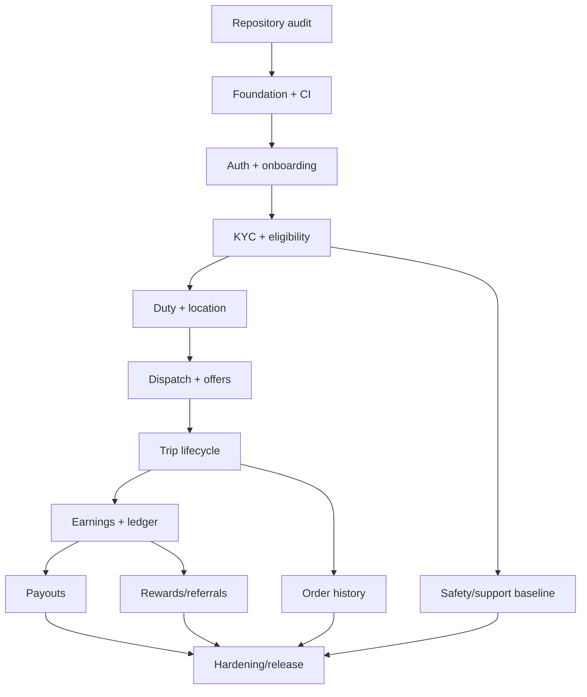

# Implementation Plan — Drive Partner

**Document ID:** DP-PLAN-001 | **Version:** 1.0

## 1. Delivery approach
Build working vertical slices, not isolated static pages. Sequence: repository discovery → foundation → identity/onboarding → eligibility/duty/location → dispatch → trip → earnings/ledger → payout → rewards/support → hardening. Every phase ends with a buildable artifact and acceptance evidence.

## 2. Workstreams
- **Android:** navigation, design system, screens, permissions, client state and API integration.
- **Backend:** API, modules, database, auth, dispatch, fare and ledger logic.
- **Operations:** KYC, support, zone setup, business policy and admin processes.
- **Platform:** Firebase, Maps, storage, database, CI/CD, secrets and monitoring.
- **Quality:** unit, integration, UI, security, concurrency and release testing.

## 3. Sequenced plan

### Step 0 — Repository discovery
- Inspect files, branches, current behavior and working tree.
- Identify existing Android/backend projects and current tech stack.
- Run current build/tests and capture failures.
- Add documentation without deleting existing project material.
- Establish dev environment and secret policy.

**Exit:** reproducible baseline build or documented blockers; no destructive changes.

### Step 1 — Foundation
- Create/confirm Android and backend projects.
- Configure environments and dependency catalog.
- Implement theme, navigation shell, API client, error model, safe logging and CI.
- Create health endpoint and database migration baseline.

**Exit:** app launches with working navigation; backend health and DB migration pass; dev/staging separated.

### Step 2 — Identity and onboarding
- Firebase phone OTP and backend token verification.
- Internal user/driver mapping.
- Profile/vehicle forms and draft persistence.
- Private upload-intent flow and document metadata.
- Reviewer approval/rejection and correction path.

**Exit:** synthetic applicant can submit documents in staging; unapproved account cannot go online.

### Step 3 — Eligibility, duty and map
- Account/category/document eligibility endpoint.
- Online/offline state machine.
- Contextual location permission and compliant foreground service where required.
- Home map, latest location, zone preferences and reconnect sync.

**Exit:** test driver goes online/offline only with backend confirmation; tracking stops appropriately offline.

### Step 4 — Dispatch and offers
- Order/offer schema and dispatch service boundary.
- Realtime events and FCM fallback.
- Offer detail/countdown/accept/reject.
- Atomic assignment and idempotency.
- Isolated Demo fixtures.

**Exit:** concurrency test proves one assignment; expired/duplicate offers are safe.

### Step 5 — Trips and history
- Trip state machine and immutable events.
- Route navigation handoff, pickup/drop and configured contact adapter.
- Arrival/start/complete/cancel.
- App restart recovery, order history and detail.

**Exit:** end-to-end trip completes exactly once and creates one earning source reference.

### Step 6 — Earnings, ledger and payout
- Versioned fare configuration and final calculation.
- Earning statement and append-only ledger.
- Wallet summary and transaction history.
- Payout account tokenization/reference and provider adapter.
- Webhook validation and reconciliation.

**Exit:** ledger balance, retry/idempotency and failure cases pass; client cannot alter funds.

### Step 7 — Incentives, referral, safety and support
- Campaign setup/progress/qualification.
- Reward posting with idempotency.
- Referral attribution and anti-fraud.
- SOS/incident and support tickets.
- Notification inbox/preferences.

**Exit:** reward credits once; support is isolated; SOS status is truthful and audited.

### Step 8 — Hardening/release
- Device, network, battery and permission testing.
- Current Android/Play policy review.
- Security and access-control review.
- Dispatch concurrency/load tests.
- Backup/restore and migration rehearsal.
- Monitoring, alerts, privacy and accessibility.
- Signing and operational runbooks.

**Exit:** all release gates in `00_MASTER.md` signed off.

## 4. Dependency graph

## 5. Parallelizable work
After foundation, UI scaffolding may run in parallel with backend schema/API development only when DTO contracts are agreed. Rewards/support can proceed after identity, driver and notification foundations. Avoid simultaneous conflicting edits to migrations or core state machines.

## 6. Change controls
- Use one phase prompt at a time from `12_PHASE_PROMPTS.md`.
- Keep changes reviewable and build/test after each slice.
- Endpoint/event changes update `04_TECHSPEC.md`/OpenAPI.
- Database changes update `05_SCHEMA (1).md` and migrations.
- Rule changes update `06_RULES (1).md`.
- Screen/UI changes update `11_SCREENS.md` and `Design.md`.
- Update `08_TRACKER.md` and `10_memory.md` with evidence.

## 7. Risk-first priority
Highest risks: KYC/privacy, location permissions, offer concurrency, trip recovery, ledger correctness, payout reconciliation and SOS. Test these before spending time on reward animation or decorative polish.
